# cp0-launcher

A personal launcher for the M5Stack CardputerZero: a terminal-styled home screen
and a small set of built-in apps sharing one theme. Forked from
[CardputerZero/launcher](https://github.com/CardputerZero/launcher) (MIT).


## Apps

The home screen lists the app types in a rail on the left and shows the apps of the highlighted type beside it.

| | |
|---|---|
| <br>Home: system | <br>Home: radio |
| 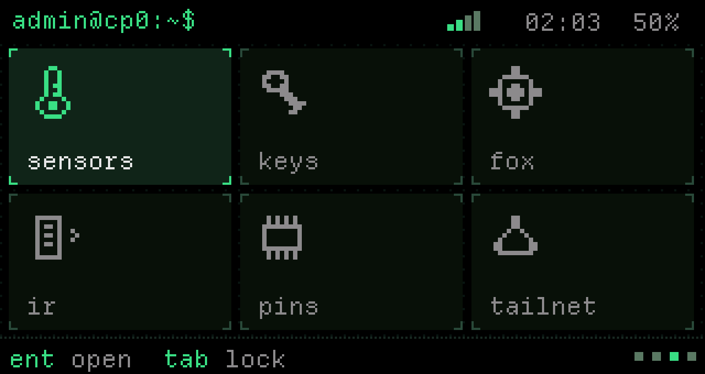<br>Home: hardware, network and play | 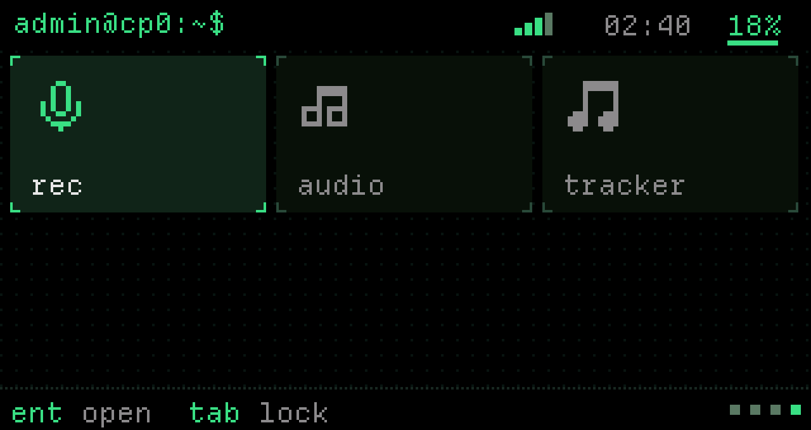<br>Home: sound |

### System

- **Settings**, **CLI**, **Python**, **SSH**, **IP Panel**.
- **Files**: browse, preview text, rename, copy/move, delete, new folders; `e` opens a file in micro.

| | |
|---|---|
| <br>Files | <br>Files: preview |
| <br>Settings | <br>Settings: battery |
| 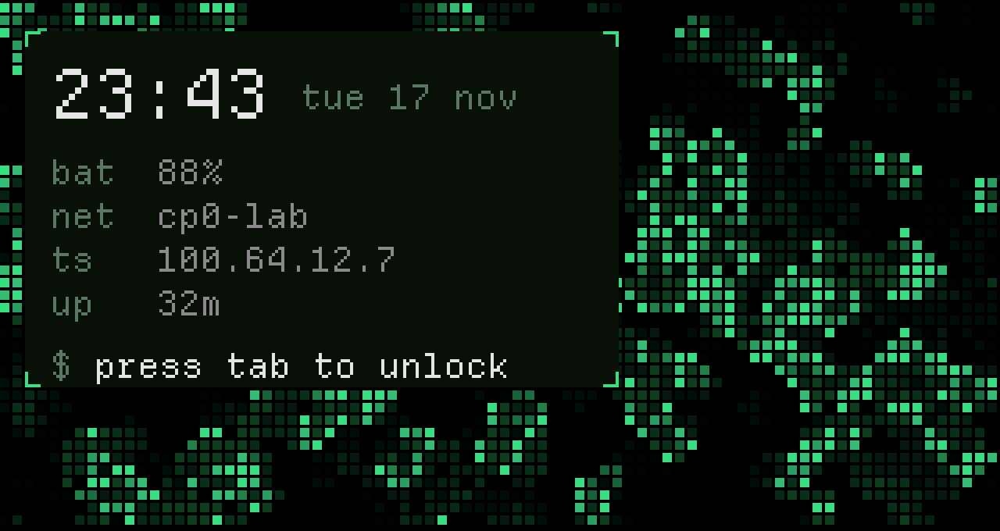<br>Lock screen |  |

### Radio

- **SDR**: RTL-SDR scope and waterfall with in-app WFM/NFM/AM demodulation to the speaker. `tab` opens a band menu that jumps to FM, AM, air, marine and other bands.
- **ADSB**: aircraft scope and flight list decoded from `rtl_adsb` on 1090 MHz. Range and bearing use the position in `~/.config/cp0/location` (one line, `lat,lon`).
- **Sat**: pass predictor and sky plot from Celestrak TLEs, for the ISS and Meteor-M by default and anything named in `~/sat/watch.txt`; records a pass as FM audio with `rtl_fm`. The orbit model is a simplified one, not SGP4.
- **Sensors**: dashboard of the 433 and 868 MHz temperature and humidity sensors that `rtl_433` decodes. `r` picks the radio: the CC1101 (default, OOK sensors) or an RTL-SDR dongle (also FSK sensors).
- **Spectrum**: sub-GHz scanner and recorder on the CC1101 radio. RX watches the 315, 433 and 868 MHz bands with per-channel level bars and auto-captures any signal over the trigger to `~/spectrum` as Flipper `.sub` and rtl_433 `.ook` files; TX lists the captures and replays one on its own frequency.
- **Keys**: looks inside the captures Spectrum saves: waveform, pulse-width decode to bits and hex, replay.

| | |
|---|---|
| <br>SDR: scope and waterfall around 433.92 MHz | 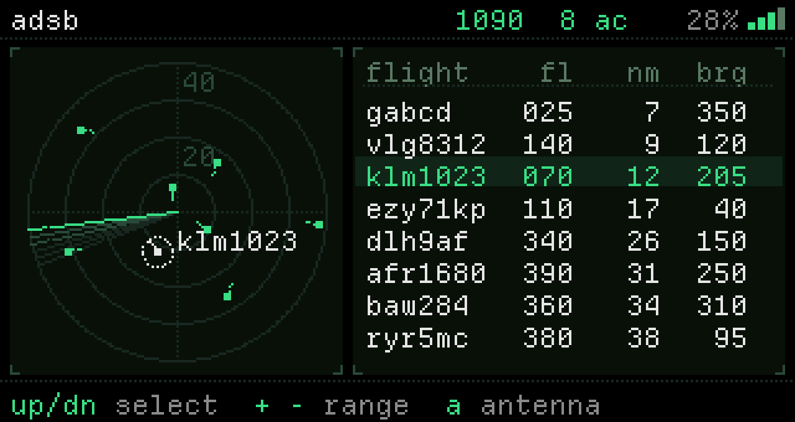<br>ADSB: scope and flight list |
| 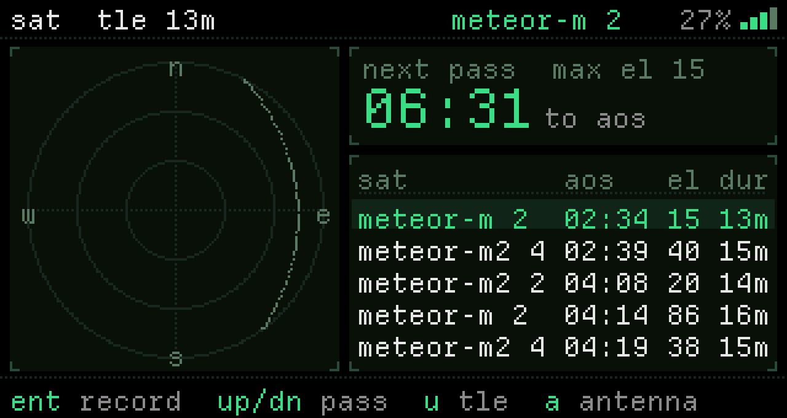<br>Sat: next passes and sky plot | 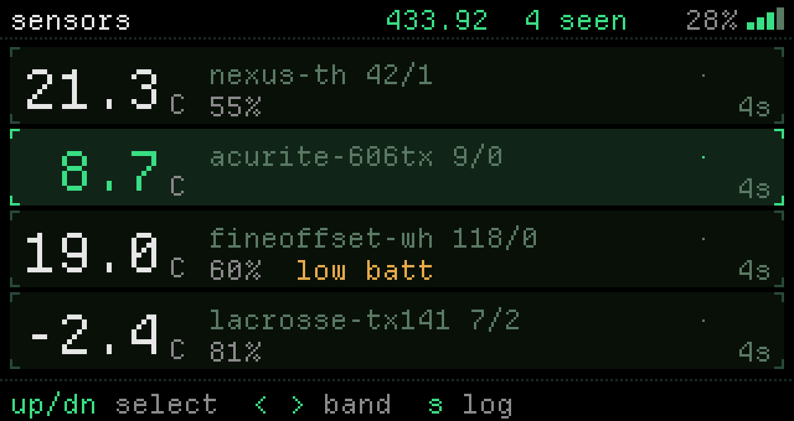<br>Sensors |
| 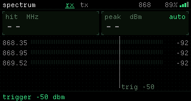<br>Spectrum: CC1101 RX | 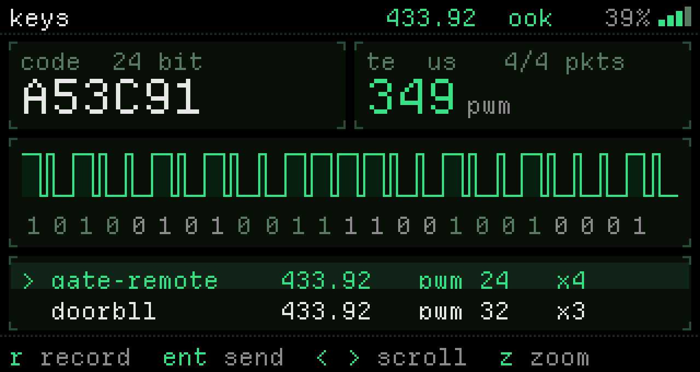<br>Keys: decoded capture |

### Hardware, network and play

- **Fox**: transmitter hunting on one frequency with a live RSSI meter, peak hold, history strip and a beep that speeds up with the signal.
- **IR**: learns an infrared remote button by button (NEC decode, raw timings otherwise) and replays it; four remotes of eight buttons.
- **Pins**: I2C bus scanner that only reads and skips addresses a kernel driver owns, and a GPIO logic view with I2C decode.
- **Tailnet**: Tailscale peers with status, path and ping; `s` opens SSH to a peer, `e` sets an exit node.
- **Air**: 2.4 and 5 GHz Wi-Fi channel map with a network list, and nearby Bluetooth devices. `w` picks the adapter that scans, so a USB adapter on `wlan1` can scan while `wlan0` stays the system Wi-Fi.
- **Portal**: brings an open test access point up and down on `wlan1` (hostapd, dnsmasq DHCP with wildcard DNS, and a static "hello" page that exercises captive-portal detection). `wlan0` stays the system Wi-Fi. Shows state and connected-client count; it serves one page (`share/images/portal/index.html`) and logs nothing a client sends. Needs `hostapd`, `dnsmasq` and `iptables`.
- **Slime**: Physarum slime-mould simulation with six species and eight colour palettes, seven of them from the PHOSPHN Game Boy Advance ROM.

| | |
|---|---|
| 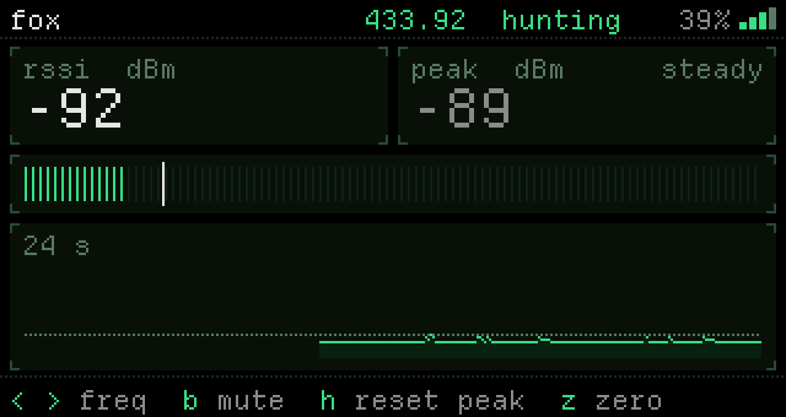<br>Fox | 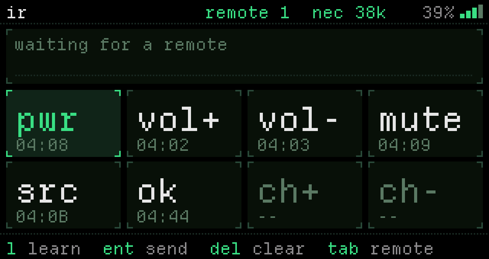<br>IR: learned remote |
| 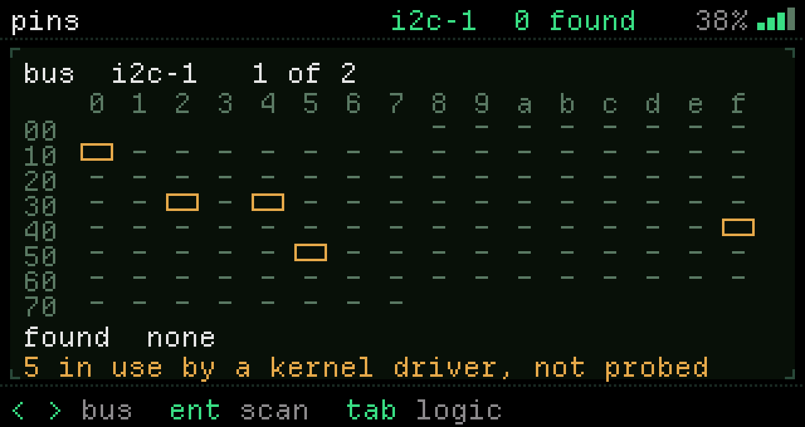<br>Pins: I2C scan | 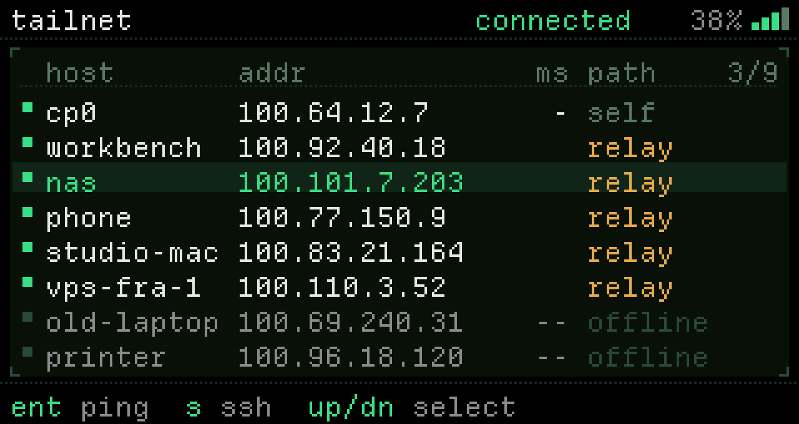<br>Tailnet |
| 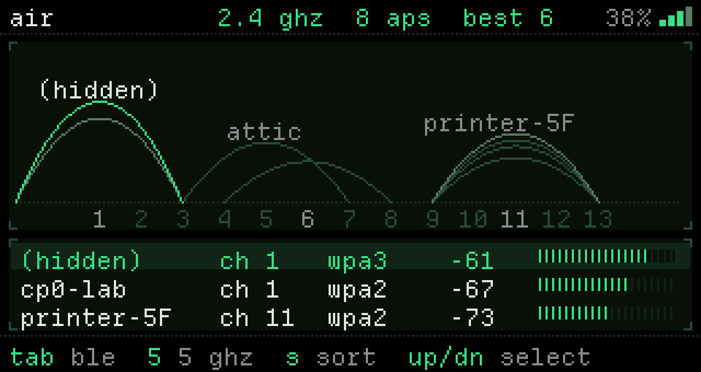<br>Air: Wi-Fi channel map | 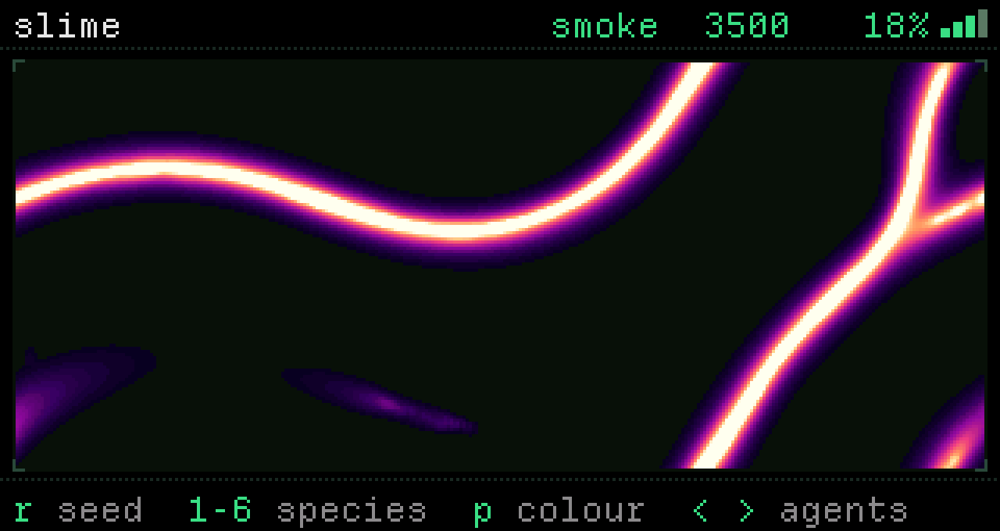<br>Slime: bioluminescence palette |

### Sound

- **Rec**: voice recorder with on-device transcription (whisper.cpp).
- **Audio**: live microphone spectrum and pitch readout.
- **Tracker**: four-channel chiptune tracker (two squares, wave, noise) with song save and WAV export.
- **Pd**: runs the Pure Data patches in `~/pd` without the Pd GUI, with the microphone on `adc~` and the speaker on `dac~`. Shows what the patch prints, and the spectrum and level of the sound output. Needs `puredata-core` and `pipewire-jack`.

| | |
|---|---|
| 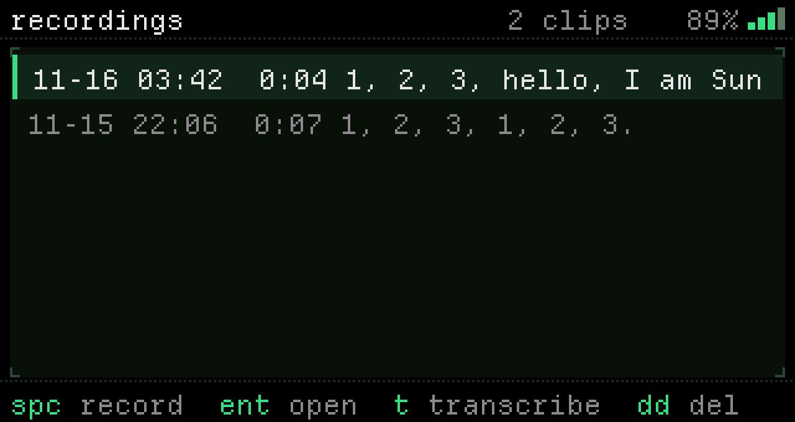<br>Rec: recordings with transcripts | <br>Rec: clip |
| <br>Audio | 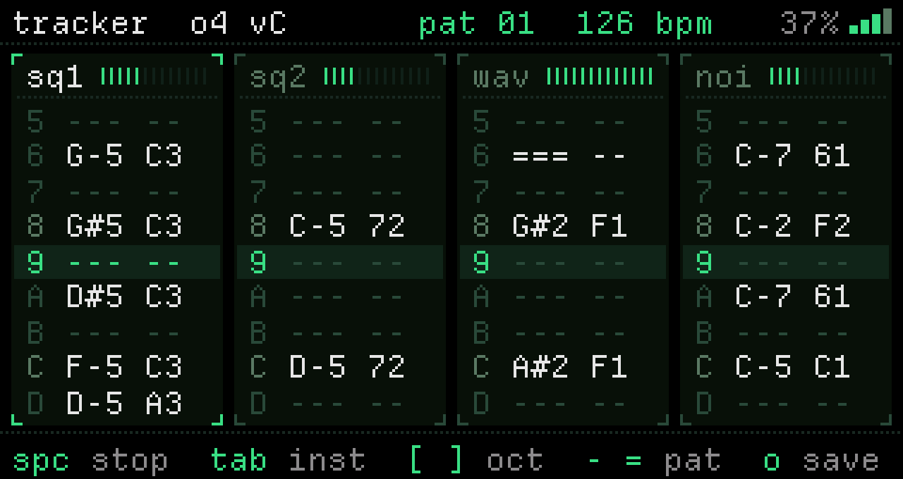<br>Tracker |

Images are the device's 320x170 framebuffer drawn at 4x; the UI font is the pixel font
DepartureMono, so the enlargement is exact. Network name and address on the lock screen,
Tailnet hosts and addresses, and Wi-Fi names are placeholders. The aircraft, sensors, Keys
capture and IR remote shown are demo data fed through the apps' own decoders.

## Install on a CardputerZero

Starting from the stock M5Stack image, on the device (CLI app or SSH):

```bash
curl -LO https://github.com/samisabik/cp0-launcher/releases/latest/download/cp0-launcher-arm64.tar.gz
tar xzf cp0-launcher-arm64.tar.gz
cd cp0-launcher && ./install.sh
```

`install.sh` replaces the launcher binary and its fonts and icons in
`/usr/share/APPLaunch`, holds the `applaunch` package and masks the stock
updaters so they do not put the stock launcher back, adds a polkit rule that
lets the launcher scan and join Wi-Fi, then restarts the launcher.

To go back to the stock launcher:

```bash
sudo cp -p /usr/share/APPLaunch/bin/M5CardputerZero-APPLaunch.stock /usr/share/APPLaunch/bin/M5CardputerZero-APPLaunch
sudo apt-mark unhold applaunch
sudo rm -f /etc/polkit-1/rules.d/50-cp0-wifi-scan.rules
sudo systemctl unmask applaunch-updater.service applaunch-apt-update.service applaunch-apps-updater.service
systemctl --user restart APPLaunch.service
```

## Build from source

Cross builds use a sysroot made from a device over SSH, or from a Debian trixie
arm64 container without one:

```bash
scripts/make_sysroot.sh cp0        # or: scripts/make_sysroot.sh --docker
cd projects/APPLaunch
CONFIG_DEFAULT_FILE=mac_cross_cp0_config_defaults.mk CONFIG_REPO_AUTOMATION=y \
CONFIG_TOOLCHAIN_PATH=/opt/homebrew/bin CONFIG_GCC_DUMPMACHINE=aarch64-linux-gnu \
uvx --from scons --with parse --with requests --with tqdm scons -j8
```

That is macOS with Homebrew's `aarch64-unknown-linux-gnu` toolchain; on Linux use
`linux_x86_cross_cp0_config_defaults.mk` with `gcc-aarch64-linux-gnu`.
`scripts/package_release.sh` then builds `release/cp0-launcher-arm64.tar.gz`.

Tests: `sh projects/APPLaunch/tests/run_tests.sh` and
`sh ext_components/cp0_lvgl/tests/run_tests.sh`. `AGENTS.md` is the detailed
guide to the code.

## License

MIT, see `LICENSE`. Third-party notices are in `LICENSES/` and
`docs/OPEN_SOURCE_COMPONENTS.md`.
