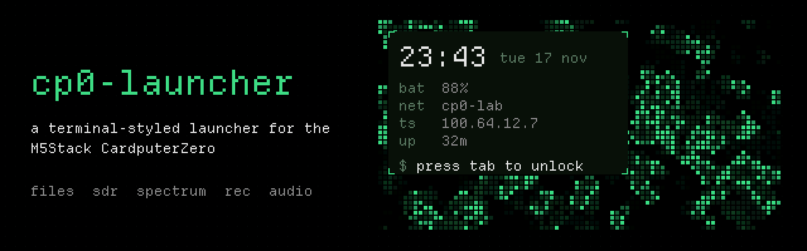
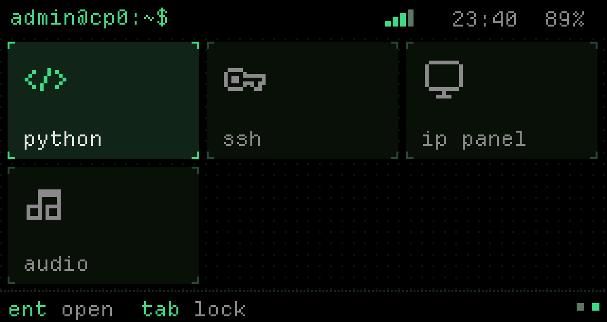
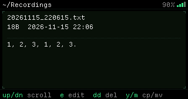
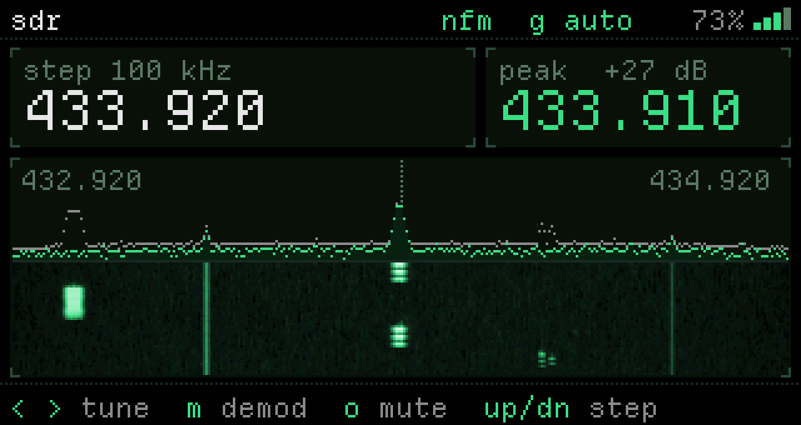
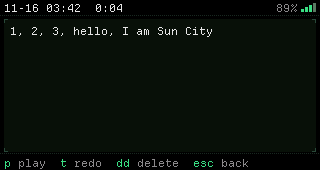

# cp0-launcher

A personal launcher for the M5Stack CardputerZero: a terminal-styled home screen
and a small set of built-in apps sharing one theme. Forked from
[CardputerZero/launcher](https://github.com/CardputerZero/launcher) (MIT).



## Apps

- **Files**: browse, preview text, rename, copy/move, delete, new folders; `e` opens a file in micro.
- **Spectrum**: sub-GHz scanner and recorder on the CC1101 radio. RX watches the 315, 433 and 868 MHz bands with per-channel level bars and auto-captures any signal over the trigger to `~/spectrum` as Flipper `.sub` and rtl_433 `.ook` files; TX lists the captures and replays one on its own frequency.
- **SDR**: RTL-SDR scope and waterfall with in-app WFM/NFM/AM demodulation to the speaker.
- **Rec**: voice recorder with on-device transcription (whisper.cpp).
- **Audio**: live microphone spectrum and pitch readout.
- **Settings**, **CLI**, **Python**, **SSH**, **IP Panel**.

| | |
|---|---|
| <br>Home | <br>Home, page 2 |
| <br>Files | <br>Files: preview |
| <br>Spectrum: CC1101 RX | <br>SDR: scope and waterfall around 433.92 MHz |
| <br>Rec: recordings with transcripts | <br>Rec: clip |
| <br>Audio | <br>Lock screen |
| <br>Settings | <br>Settings: battery |

Images are the device's 320x170 framebuffer drawn at 4x; the UI font is the pixel font
DepartureMono, so the enlargement is exact. Network name and address on the lock screen
are placeholders.

## Install on a CardputerZero

Starting from the stock M5Stack image, on the device (CLI app or SSH):

```bash
curl -LO https://github.com/samisabik/cp0-launcher/releases/latest/download/cp0-launcher-arm64.tar.gz
tar xzf cp0-launcher-arm64.tar.gz
cd cp0-launcher && ./install.sh
```

`install.sh` replaces the launcher binary and its fonts and icons in
`/usr/share/APPLaunch`, holds the `applaunch` package and masks the stock
updaters so they do not put the stock launcher back, then restarts the launcher.

To go back to the stock launcher:

```bash
sudo cp -p /usr/share/APPLaunch/bin/M5CardputerZero-APPLaunch.stock /usr/share/APPLaunch/bin/M5CardputerZero-APPLaunch
sudo apt-mark unhold applaunch
sudo systemctl unmask applaunch-updater.service applaunch-apt-update.service applaunch-apps-updater.service
systemctl --user restart APPLaunch.service
```

## Build from source

Cross builds use a sysroot made from a device over SSH, or from a Debian trixie
arm64 container without one:

```bash
scripts/make_sysroot.sh cp0        # or: scripts/make_sysroot.sh --docker
cd projects/APPLaunch
CONFIG_DEFAULT_FILE=mac_cross_cp0_config_defaults.mk CONFIG_REPO_AUTOMATION=y \
CONFIG_TOOLCHAIN_PATH=/opt/homebrew/bin CONFIG_GCC_DUMPMACHINE=aarch64-linux-gnu \
uvx --from scons --with parse --with requests --with tqdm scons -j8
```

That is macOS with Homebrew's `aarch64-unknown-linux-gnu` toolchain; on Linux use
`linux_x86_cross_cp0_config_defaults.mk` with `gcc-aarch64-linux-gnu`.
`scripts/package_release.sh` then builds `release/cp0-launcher-arm64.tar.gz`.

Tests: `sh projects/APPLaunch/tests/run_tests.sh` and
`sh ext_components/cp0_lvgl/tests/run_tests.sh`. `AGENTS.md` is the detailed
guide to the code.

## License

MIT, see `LICENSE`. Third-party notices are in `LICENSES/` and
`docs/OPEN_SOURCE_COMPONENTS.md`.
